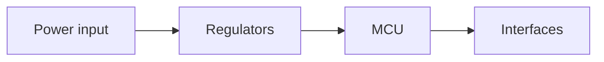

Describe the design here: purpose, architecture, key decisions. This section
is `site/content/design/`; every Markdown file you add appears in the sidebar.

## Block diagram

Diagrams are Mermaid code blocks (a fenced block with the language
`mermaid`), rendered in the browser with no external services:

## Specifications

| Parameter | Value |
|---|---|
| Supply | |
| Board size | |
